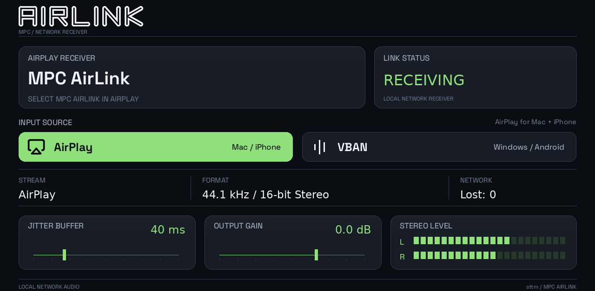

# MPC AirLink

VBAN and AirPlay audio receiver for Akai MPC Standalone. A native VST2 instrument by **sttm**, with a dark, low-resource card interface and stereo output on its plugin track.



[Русская инструкция](README.ru.md) · [Validation](docs/VALIDATION.md) · [Third-party notices](THIRD_PARTY.md)

## Install — MPC OS 3.10.1 or later

Download **mpcairlink-1.1.1-mpc.zip** from [Releases](https://github.com/sttm/mpcairlink/releases).
Extract it into the root of an SD card or USB drive. Keep this folder intact:

```
VST2 Plugins/sttm - VST - MPC AirLink/
```

On the MPC, enable **Preferences → Enhancements (Beta) → Enable Enhancements** and **External Plugin Support**, then restart. Create a Plugin track and select **External Plugins → sttm → MPC AirLink**. Route the track to Main Out and leave the drive connected. No MIDI notes or sequencer playback required.

The combined USB package includes ARMv7 hard-float (Gen1) and AArch64 (Gen2). Separate per-CPU catalog packages are also supplied for Open MPC's installer. This release requires OS 3.10.1+, including when using those packages.

## Receive audio

- **iPhone / Mac:** join the same LAN, leave AirPlay selected (the default), then select **MPC AirLink** in the sender's AirPlay audio menu. This is classic AirPlay 1 / RAOP audio, not screen mirroring or AirPlay 2. Its normal latency is about two seconds.
- **VBAN:** choose VBAN. Send audio to the IPv4 address shown on the plugin, UDP **6980**, PCM16/24 or float32, mono/stereo. Any stream name is accepted. Prefer 44.1/48 kHz and **256 frames per packet**. Start with jitter 150 ms on Wi-Fi.
- **VBAN Talkie:** TX destination = MPC IP, port 6980, name Stream1 (any name works), PCM16, 48 kHz, mono or stereo. Enable microphone/local-network permissions and transmission. Talkie sends its microphone input.
- AUTO has been removed. Old saved AUTO values map to AirPlay. One active source is received at a time; use one plugin instance per MPC.

Q-Link 1/2/3 control source, jitter (10–150 ms, default 40), and gain (−24…+12 dB, default 0). STREAM shows the AirPlay receiver name or VBAN address, receive status, format and meters; DIAG shows packet loss, FIFO drops and underruns. AirPlay uses at least 120 ms of local buffering in addition to protocol latency.

VBAN resampling follows source and host rates with linear interpolation and a small FIFO clock correction. It is not a bandlimited converter. Network gaps exceeding the buffer still cause interruptions; use a reliable LAN without client isolation. Multicast mDNS discovery must be allowed for AirPlay.

## Build from source

With Docker Desktop running on macOS (or Docker on Linux):

```sh
./build.sh
```

This uses a Debian bookworm linux/amd64 container and `arm-linux-gnueabihf-g++` / `aarch64-linux-gnu-g++`, builds both VST binaries and bundled Shairport Sync helpers, runs native tests, generates the skin, validates the folder and packages the USB ZIP. First build needs network access to Debian and Docker Hub. Outputs are in `build/VST2 Plugins/` and `dist/`.

```sh
./build.sh test
./build.sh airplay-test
./build.sh sanitize
```

Core/parser/SPSC/SRC, actual UDP loss/reordering, VST host, RTSP/RTP PCM and encrypted ALAC are tested. User confirmed **v1.0.0** on **MPC Key 61 / OS 3.10.1**, 2026-11-16; tested.json retains that historical version. **The v1.1.1 UI and actual display FPS have not yet been tested on MPC hardware.** **Gen2 is cross-compiled and ELF-validated only; no physical Gen2 test is claimed.** Long-duration and all host workflows still need broader testing.

## Implementation and licences

C++17, POSIX sockets, one network worker and a lock-free stereo SPSC FIFO. No allocation, locks or I/O in the audio callback. AirPlay runs an isolated bundled Shairport Sync 4.3.7 process with TinySVCmDNS; no Avahi/D-Bus/system service or firmware modification. Helper libraries are loaded only in that child process. Temporary helper files use a private `/tmp` directory and are cleaned up on unload.

First-party code and the vendored inMusic SDK are MIT. Shairport/ALAC are MIT, TinySVCmDNS BSD-3-Clause, OpenSSL Apache-2.0, libconfig LGPL-2.1-or-later and libpopt MIT. Static captions use Space Grotesk (OFL-1.1); the original AIRLINK wordmark is generated from geometric paths. No font binaries ship in the plugin ZIP. Font/artwork notices remain in the repo and packages; live text uses the MPC host's font. Full notices and corresponding libconfig source accompany the binaries. See [THIRD_PARTY.md](THIRD_PARTY.md).

Plugin ID **mpcairlink**, VST UID **ArLk**. Earlier local MPC StreamIn builds have a different identity; replace old project slots manually. This is an independent community plugin, not an Akai, Apple or VB-Audio product.

## Version 1.1.1

AirPlay is the default source; the public source selector has only AirPlay and VBAN.
The first 14 parameter IDs remain stable; Source (14) and Meter Refresh (15) are appended.
The display worker samples meters at a target 24 Hz (DIAG offers 10 Hz), with 120 ms
release and 22 complete LED blocks per channel. Unchanged levels/statuses send no
host event. Status polling runs separately at up to 10 Hz; no host UI callbacks run
in the audio or receive path. The measured timer cadence is not a claim about MPC
compositor FPS. Rounded cards and icons are static PNGs, not runtime vector effects.

Track-title metadata, cover art and AirPlay 2 remain disabled. A successful RTSP
OPTIONS after teardown is tested; full iPhone reconnect/album-end behaviour and
long-duration physical Wi-Fi playback still need device testing. If an iPhone
cannot reconnect, try VBAN → AirPlay to restart discovery/service. This release
does not claim a confirmed fix for that previously reported iPhone issue.
